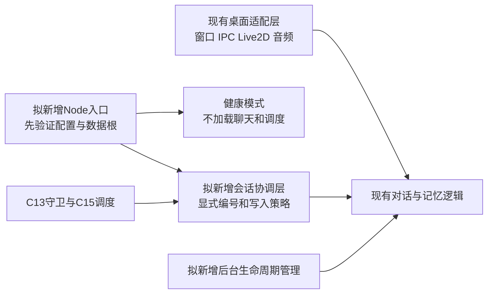

# S-11 无界面核心依赖盘点与拆分清单

日期：2026-10-25。盘点源码基线：Git `ff20684`，正式目录`F:\elysia\爱莉希雅`。本轮只静态读取源码和完善实施方案，没有加载应用模块、调用模型、读取凭据内容或改写正式数据。

## 1. 结论与范围

采用独立Node入口、显式会话协调层和可注入的生命周期管理，复用已有对话、人格、记忆及渠道模块。现有`脑/对话.cjs`已经与窗口分开，并提供记忆/后台开关；迁移的主要工作是补齐会话归属、严格配置/凭据边界、后台任务的停止协议，以及将桌面事件留给适配层。

S-12拆为A/B/C三个依次验收的小步：先独立启动与健康状态，再显式会话读写和假模型回环，最后真实模型联通与后台生命周期验证。原S-12父编号和其后存储选择、渠道验证、资源测量与购买顺序保留。此次是静态盘点引出的实现细化，没有新增产品能力。

本轮没有进行Linux实测或Node模型对话，也不把源码可复用视为已完成兼容性验证。

## 2. 现有入口与目标分界

正式入口为`F:\elysia\start-all.cmd` → `start-all.cjs` → `爱莉希雅/tools/启动桌宠.cjs`，桌面包的`main`仍为`main.js`，`npm start`仍运行Electron。安装版在加载脑模块前重定向用户目录，说明路径初始化必须先于模块加载。

图中的Node入口、会话协调层和后台生命周期管理均为待实现部分。现有桌面暂不改接新服务，正式桌面/远端核心衔接仍在W-11至W-13验证；共同底层逻辑继续复用，避免复制一整份main.js的处理链。

## 3. 模块归属清单

| 现有部分 | 后续归属与处理 | 源码证据 |
|---|---|---|
| app/BrowserWindow/Tray/Menu/ipcMain/session/shell/Notification/screen | 留在桌面层；Node入口不导入main.js或伪造Electron对象 | [main.js:33](F:/elysia/爱莉希雅/main.js:33) |
| 安装版用户目录准备、Windows safeStorage、设置页密钥操作 | 留在桌面适配；服务进程采用显式路径与凭据提供方式 | [main.js:42](F:/elysia/爱莉希雅/main.js:42)、[main/secret-store.cjs:12](F:/elysia/爱莉希雅/main/secret-store.cjs:12) |
| 对话请求、标记清理、人格边界、工具回执、上下文预算 | 复用现有核心；由独立服务协调明确的模式、会话、取消和回调 | [脑/对话.cjs:571](F:/elysia/爱莉希雅/脑/对话.cjs:571) |
| 提示词、角色卡、表达反馈、记忆叙述、时间意识 | 保留现有人格和记忆规则；角色卡及工作区路径显式配置 | [脑/提示词.cjs:34](F:/elysia/爱莉希雅/脑/提示词.cjs:34) |
| 即时情感与缓慢情绪 | 计算可复用，按内部对话编号处理；UI/Live2D表现事件由适配层消费 | [main.js:1923](F:/elysia/爱莉希雅/main.js:1923)、[脑/情感状态.cjs:46](F:/elysia/爱莉希雅/脑/情感状态.cjs:46) |
| 窗口历史缓存与当前模式/模型 | 不移植窗口编号；协调层按内部对话编号管理历史、模式、模型和记忆开关 | [main.js:3418](F:/elysia/爱莉希雅/main.js:3418) |
| 事实/经历/小本子、临时记忆、关系图、召回 | 保留已有格式和规则；补齐显式会话来源、隔离根和写入结果处理 | [脑/记忆.cjs:324](F:/elysia/爱莉希雅/脑/记忆.cjs:324)、[脑/记忆.cjs:589](F:/elysia/爱莉希雅/脑/记忆.cjs:589) |
| 用量与长度对账 | 属于核心运行数据；所有真实请求继续记账，隔离测试必须使用隔离目录 | [脑/对话.cjs:487](F:/elysia/爱莉希雅/脑/对话.cjs:487) |
| 普通日记、private日记、关系整理、聚类就绪、临时提取 | 算法复用，启动/停止和在途任务由唯一生命周期所有者管理，详见第5节 | [main.js:3499](F:/elysia/爱莉希雅/main.js:3499) |
| 主动陪伴的规则/生成器与桌面空闲检测 | 规则可复用，当前桌面入口仍留本机；云端主动外发须单独适配C13/C15及后续渠道能力，不在S-12自动启用 | [main.js:516](F:/elysia/爱莉希雅/main.js:516) |
| Live2D、bridge键盘/队列、TTS/ASR、账本窗口 | 留在桌面层，不随健康进程启动；云端只保留需要的文本/用量事件 | [main.js:62](F:/elysia/爱莉希雅/main.js:62)、[tools/bridge.cjs:68](F:/elysia/爱莉希雅/tools/bridge.cjs:68) |
| Windows进程检查与收摊 | 留在本机；Node退出只处理中止信号、自有任务/子进程和存档，不调用taskkill/PowerShell收摊 | [main.js:1644](F:/elysia/爱莉希雅/main.js:1644)、[脑/收摊.cjs:80](F:/elysia/爱莉希雅/脑/收摊.cjs:80) |
| 文件/命令/学习任务/子代理与确认窗口 | 保留既有权限边界；首版渠道聊天固定chat，不把客户端正文当工作模式或桌面目录授权 | [脑/工具表.cjs:328](F:/elysia/爱莉希雅/脑/工具表.cjs:328)、[脑/确认.cjs:200](F:/elysia/爱莉希雅/脑/确认.cjs:200) |
| C11契约、C13权限、C14映射、C15任务调度 | 作为服务侧唯一受信渠道入口复用；不绕过调度另挂一个自动回复处理器 | [脑/渠道任务调度.cjs:29](F:/elysia/爱莉希雅/脑/渠道任务调度.cjs:29) |

包内仍声明Electron、Live2D渲染和本机声音相关依赖，不据此认定它们都是无界面进程的必需依赖。健康入口只需Node内置模块；聊天阶段再核对实际导入闭包和资源，S-17之前不做服务器配置性能结论。当前本机工具Node为v26.8.2，源码使用fetch/AbortSignal.any等能力，目标Linux运行时须实测这些能力，尚未选定部署版本。

## 4. 必须先处理的耦合点

| 编号 | 已核实的现状 | 后续具体处理与通过标准 |
|---|---|---|
| H-01 启动顺序 | 配置模块加载时读取工作区配置；数据/缓存默认回到正式项目，多个模块在顶层固定路径 | S-12A先验证显式配置与隔离数据根，再允许后续懒加载；缺少、错误或指向正式数据的测试配置拒绝启动，不能退回默认目录 |
| H-02 会话历史 | main缓存键是窗口编号；记忆的读聊天记录按模块全局当前对话过滤 | S-12B增加兼容的显式编号读接口/协调层，按内部编号读历史；处理渠道消息不调用设当前对话切换桌面指针 |
| H-03 写入归属 | 存聊天已支持第三参选项.对话且返回布尔值，但对话.cjs的两处调用未传第三参，也未检查返回值 | S-12B把选项.对话编号传至最终写入口，检查写入结果；失败不报持久化成功，旧API默认行为保持兼容；增加两段交错写读测试 |
| H-04 新建会话 | 建新对话自行生成d开头编号，并切换全局当前会话，与C14固定channel编号不一致 | S-12B提供受信的显式编号登记/查询，不借普通新建入口改当前会话；重启后沿用映射编号，模型不能指定或合并编号 |
| H-05 Node默认门控 | 对话.cjs以process.versions.electron决定默认记忆与后台行为，但已有记进记忆、写长期记忆、后台整理、后台关系整理、后台提取显式覆盖 | 服务显式传策略，不伪造process.versions.electron；纯测试默认不启用后台网络，关闭长期记忆不等于停止聊天留档 |
| H-06 提取后的调度 | 临时记忆提取中自主晋升后的关系/聚类排队仍直接判断Electron | S-12C改为显式生命周期通知/策略，保留桌面兼容；测试确认Node中获准的晋升能通知，禁用时不产生任务，不改变评分/门槛 |
| H-07 凭据回退 | 拿钥匙实际优先级为安全环境值→项目钥匙文件→普通环境值→DSH；仅设置普通环境值仍可能先读项目钥匙 | S-12B/C采用严格提供器/显式连接，不允许服务静默读本机钥匙或DSH；桌面safeStorage继续原路径，Windows加密文件不复制到服务测试目录 |
| H-08 计时与退出 | 启动周期计时器在main，模块另有防抖/缓冲和在途网络；清计时器不等于任务已结束 | S-12C提供有界停止/等待协议和关闭后不再写入测试；正式服务接管、残锁和崩溃运维继续留S-16 |
| H-09 全局工具状态 | 路径安全/命令目录、没干完的当前纸条、长度锚等仍有模块级状态 | 首版一个服务实例内串行执行核心，C15之外也不开放任意并发入口；工作/学习留原桌面权限，不宣称已完成任意模式多会话并行 |
| H-10 返回值与日志 | 核心返回她说的话、原始、记忆标记、工具和上下文等；旧日志可能包含工具参数/错误原文 | 服务只将最终可见文本转换为C15三字段shared草稿；诊断使用白名单，不能把旧stdout或完整结果透传渠道/协议输出 |
| H-11 时间线 | 渠道发生于是UTC，旧记忆时间与日记自然日使用本地Date；提取回调部分时间默认取当前时刻 | S-12B接口明确原消息时刻与未知值，区分发生/接收/写入时间；业务自然日用Asia/Shanghai，S-12C验证跨午夜、重放不改原时间，不给旧记录推测补时区 |

关键证据：H-01见[配置.cjs:13](F:/elysia/爱莉希雅/脑/配置.cjs:13)；H-02/H-04见[记忆.cjs:493](F:/elysia/爱莉希雅/脑/记忆.cjs:493)；H-03见[对话.cjs:1259](F:/elysia/爱莉希雅/脑/对话.cjs:1259)；H-05见[对话.cjs:1187](F:/elysia/爱莉希雅/脑/对话.cjs:1187)；H-06见[临时记忆提取.cjs:277](F:/elysia/爱莉希雅/脑/临时记忆提取.cjs:277)；H-07见[钥匙.cjs:61](F:/elysia/爱莉希雅/脑/钥匙.cjs:61)；H-09见[对话.cjs:838](F:/elysia/爱莉希雅/脑/对话.cjs:838)；H-11见[记忆.cjs:73](F:/elysia/爱莉希雅/脑/记忆.cjs:73)及[对话.cjs:1276](F:/elysia/爱莉希雅/脑/对话.cjs:1276)。

已有存聊天返回false，而非没有写入结果接口；已有对话开关可显式覆盖，而非Node完全不能写记忆。优先复用这些能力并修正调用归属，不扩大成全量存储重写。长期事实仍是同一本人共享的人格记忆，对话历史分段不等于多用户记忆隔离；群聊和陌生人继续关闭。

## 5. 后台任务与退出盘点

| 任务 | 当前触发/状态 | 当前停止边界 | 后续要求 |
|---|---|---|---|
| 普通日记 | main启动15秒后、每15分钟唤醒；模块持久任务+运行中合并一次 | main清外层定时器；模块未提供完整stop/drain | 生命周期拥有外层触发；补在途生成/写入收尾，不重复创建默认系统 |
| private日记 | 工厂显式启用，默认首次45秒、每30分钟；main从配置启动 | 停止清两个计时器，不取消正在整理一天的Promise | 继续保留现有触发/每日上限/隐私规则；未获准迁移正式private，不复制本机数据；隔离测试默认关闭真实生成 |
| 关系整理 | main首次30秒、每30分钟；内部45秒防抖/10分钟最小间隔 | 取消清内部计时器、原因和待补标志 | 一个所有者管理周期与防抖，保持已有安全关系筛选和时间顺序 |
| 聚类就绪 | main首次45秒、每30分钟；内部60秒防抖/10分钟间隔 | 取消清计划，不等于所有任务均已等待完成 | 仍只候选/门控，不开启M-22/M-23，不降低真实数据门槛 |
| 事实整理 | 对话后排队，两个模型判定后本地应用，运行中合并一次 | 当前仅排队/状态，无完整外部取消等待 | 未具备停止协议前显式不启用后台模型任务；后续补中止或有界等待及失败记录 |
| 临时记忆提取 | 每段三轮或五分钟刷新，内存队列/缓冲；工厂和默认实例并存 | 可刷新，但无完整停止/等待接口；刷新还可能新增网络任务 | 停机先禁新入队，不把刷新全部当作停止；明确未完成批次处理，保留60分自主晋升等原规则 |
| 主动陪伴 | 桌面空闲/界面忙碌、当前对话和单独账本 | 调度可停，生成有中止 | 桌面保持现状；云端主动外发在后续能力/授权步骤处理 |
| C15任务 | 接收后推进，重连/到期由调用方驱动，没有自建周期计时器 | 关闭保守记录interrupted/unknown并释放自己的资源 | 生命周期负责唯一推进驱动，不再另挂一个核心订阅；保持恢复授权规则 |

停止顺序拟为：禁止新接收/新入队 → 停止周期与防抖 → 向前台/后台传播中止并有界等待 → 保存未完成/不确定状态 → 关闭C15并释放自有锁/资源。不能借用Windows收摊或按进程名清理其他程序，也不声称目前所有模块已实现这个顺序。

## 6. 配置、凭据与隔离约束

S-12A先实现一个轻量启动清单。后续允许加载业务模块之前，须明确配置文件、工作区、角色卡、数据、缓存、学习区、附件与未完成纸条位置；所有写入目标归入隔离根，验证实际路径与必要父目录，防止工作目录、环境继承或链接导致回到正式目录。

现有相关变量为`ELYSIA_WORKSPACE_ROOT`、`ELYSIA_CONFIG_FILE`、`ELYSIA_PERSONA_PATH`、`ELYSIA_DATA_DIR`、`ELYSIA_CACHE_DIR`、`ELYSIA_学习区`，以及遗留`ELYSIA_附件目录`、`ELYSIA_纸条目录`、`ELYSIA_进度文件`。启动器应拒绝或重设不属于隔离根的遗留覆盖；不能只改ELYSIA_DATA_DIR就认为所有读写已隔离。源码目录只读，保留工作区/项目层次。

健康模式不调用说话、体检、有哪些模型、拿钥匙或日记唤醒；这些接口可能读本机凭据、产生请求或安排写入。纯Node默认不写聊天并不代表没有其他写入：真实请求仍会写用量和尺子对账，所以后续真实模型测试也必须隔离这些目录。

凭据只由受信运行环境/提供器进入内存，不放命令行参数、日志、健康输出、Git或普通配置正文。缺凭据只使模型能力未就绪，不能因此回退扫描本机。健康、业务就绪和真实平台连接状态分别表达，健康成功不能宣称模型或渠道已联通。

首版健康入口采用本地CLI/stdio，不默认开放网络监听或管理端口。后续实际服务认证、单实例、资源限制和部署方式仍按S-16及后续方案验证。

## 7. S-12实施顺序与验收门

| 步骤 | 具体工作 | 验收门 | 状态 |
|---|---|---|---|
| S-12A 独立启动与健康 | 拟新增Node启动入口/配置校验；只健康模式，输出固定白名单状态，接收本地退出信号；没有业务模块/网络/定时任务 | 新Node子进程无Electron依赖，缺/错路径拒绝且不回退，健康输出无秘密，退出干净，正式目录不被写入 | 下一步可开始 |
| S-12B 显式会话与假模型 | 协调器复用原对话/人格；补显式编号登记、读写归属/回执，严格凭据接口及诊断边界；假模型接C15，先不启用后台网络 | A/B会话隔离、重启编号稳定、重复只处理一次，写失败不谎报成功、private不进入提示/草稿、普通/临时/长期开关与人格契约兼容 | 等A完成 |
| S-12C 真实联通与生命周期 | 在独立测试数据上完成一次有总超时/请求预算的真实模型会话；补单组后台生命周期和Node通知，按任务分别用虚构来源/假时钟验证 | 正式数据未污染，取消和停止后无迟到写入；日记/关系/聚类/提取规则不变，跨日时间线正确；真实花费如实进入隔离用量 | 等B完成 |

三个小步各自完成后都写验收及双记录并停下。C中的“一次对话”不等于一次HTTP请求：重试、搜索和增强召回都可能额外请求，实施时须明确预算与停止方式。真实模型验收必须显式开启并具备受信凭据；没配置时保留待验证状态，不能假称联通。

拟议文件落点（均尚未创建，具体命名可在对应步骤调整并记账）：

| 步骤 | 拟议落点 | 责任 |
|---|---|---|
| A | `core/运行配置.cjs`、`tools/启动无界面核心.cjs` | 使用内置fs/path解析显式配置并验证隔离根；健康模式仅输出版本、模式、健康状态及业务未就绪等固定白名单，本地退出不碰其他程序 |
| B | `core/对话服务.cjs`与原有记忆/对话模块的小接口调整 | 接受受信消息和内部对话编号，统一历史、情感、策略、最终结果与写入回执；凭据与测试模型通过受信接口进入，不复制整份main处理器 |
| C | `core/后台任务.cjs`及现有后台模块的生命周期补充 | 统一注册/启停/有界等待，保持每类任务一组所有者；暴露计数/状态而非记忆正文，按原配置分别启用 |

S-12A不提前实现B/C，不接真实账号、不迁移正式数据、不自动启用private生成。S-13/S-14仍比较并由用户选择存储方案；S-16才做常驻运维与服务驱动，C-16/Q-11继续验证实际平台。正式桌面和服务不能同时写同一正式数据根，切换仍按S-23处理。

## 8. 通过标准与回退

本盘点以源码静态核对为依据，关键入口、会话读写、六类记忆后台、主动陪伴、凭据、平台操作和退出边界已记录。文中新增接口/文件组织是实施约束与拟议方案，均未生成实现。

S-11完成只表示盘点和下一步边界明确，不表示无界面服务、模型对话或Linux兼容已经通过。无需重启现有应用或用户判断界面。回退仅撤回本轮文档及对应步骤状态，运行程序和正式数据无须回滚。具体核对项见`验收-无界面核心依赖盘点-S11-2026-10-25.md`。
